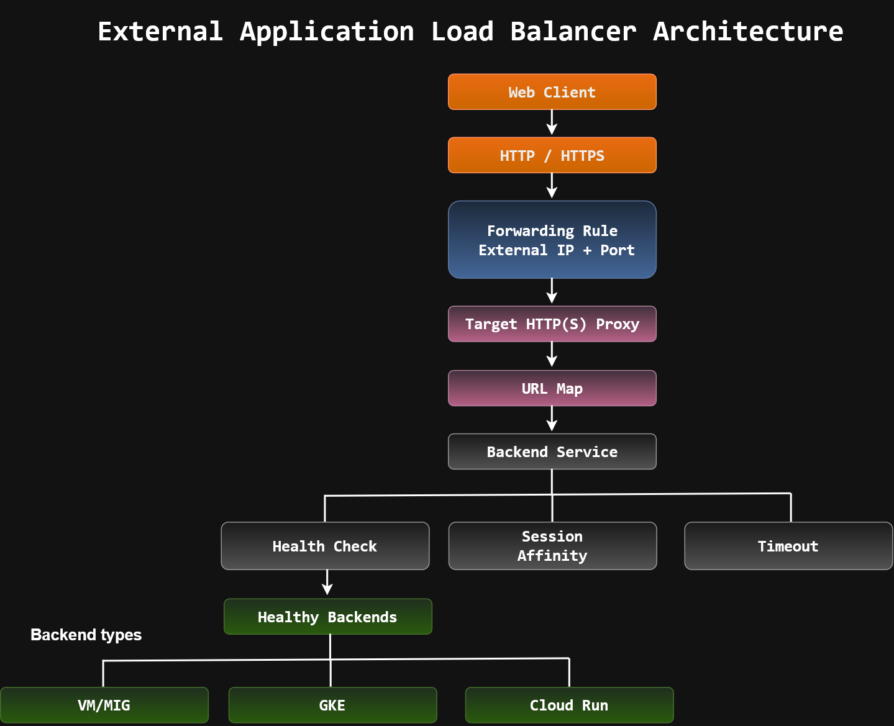

## Application Load Balancing

Application Load Balancers operate at Layer 7 of the OSI model and distribute HTTP and HTTPS traffic.

Because they operate at the application layer, routing decisions can be based on the content of a request, including URL paths.

### Deployment Modes

External Application Load Balancers can be deployed as:

- Global external
- Regional external
- Classic

Global external Application Load Balancers use Google's global network to direct traffic toward healthy backends with available capacity.

## External Application Load Balancer Architecture



The basic request flow is:

```text
Web Client
    ↓
HTTP / HTTPS
    ↓
External Forwarding Rule
    ↓
Target HTTP(S) Proxy
    ↓
URL Map
    ↓
Backend Service
    ↓
Healthy Backend
```

### Forwarding Rule

The external forwarding rule defines:

- External IP address
- Frontend port
- Target HTTP(S) proxy

Clients connect to the load balancer using the configured IP address and port.

### Target HTTP(S) Proxy

The target HTTP(S) proxy receives the client request.

It evaluates the request with a URL map to determine where the traffic should be routed.

For HTTPS traffic, the proxy can also use SSL certificates to authenticate and terminate encrypted connections.

### Backend Services

A backend service distributes requests to healthy backends.

Backend services can include:

- Health checks
- Session affinity
- Timeout settings
- One or more backends

The default backend timeout discussed in the course is:

```text
30 seconds
```

This is a fixed request timeout rather than an idle timeout.

### Health Checks

Health checks determine which backend instances are allowed to receive new traffic.

```text
Healthy backend
→ Can receive requests

Unhealthy backend
→ Does not receive new requests
```

### Session Affinity

Application Load Balancing normally distributes requests among available instances.

Session affinity can instead attempt to send requests from the same client to the same backend VM.

### Backend Types

Application Load Balancers can distribute traffic to several backend types, including:

- Compute Engine
- Google Kubernetes Engine
- Cloud Storage
- App Engine
- Cloud Run
- Cloud Run functions
- Backends external to Google Cloud

### Balancing Modes

A backend can use a balancing mode based on:

```text
CPU utilization
or
Requests per second (RPS)
```

The balancing mode determines when a backend is considered fully utilized.

If all backends in one region reach capacity, requests can be routed to another region with available capacity.

### Capacity Scaler

The capacity scaler controls how much of a backend's configured capacity should actually be used.

Example:

```text
Balancing target = 80% CPU
Capacity scaler  = 100%
→ Use the full configured target

Balancing target = 80% CPU
Capacity scaler  = 50%
→ Use approximately half of that backend capacity
```
---

## Cross-Region and Content-Based Load Balancing
### Cross-Region Load Balancing

A global Application Load Balancer can direct users to the closest healthy backend that has available capacity.

For example:

```text
North America user
→ us-central1-a backend

EMEA user
→ europe-west1-d backend
```

If the closest backend has no healthy instances or no available capacity, the request can be sent to the next closest region.

```text
Closest region unavailable
        ↓
Next closest healthy region
```

This is called **cross-region load balancing**.

### Content-Based Routing

Application Load Balancers can also route requests based on URL paths.

A URL map determines which backend service should receive the request.

Example:

```text
/video
→ video backend service

all other paths
→ default web backend service
```

This allows multiple application components to be served through a single global IP address.

---

### ACE Recognition Notes

```text
HTTP / HTTPS traffic
→ Application Load Balancer

Layer 7 routing
→ Application Load Balancer

Route by URL
→ URL map

Client connection entry point
→ Forwarding rule

Receives HTTP(S) requests
→ Target HTTP(S) proxy

Distributes traffic to healthy resources
→ Backend service

Determine backend health
→ Health check

Keep a client on the same backend
→ Session affinity

Backend full-usage measurement
→ Balancing mode

CPU utilization or RPS
→ Backend balancing mode
```
