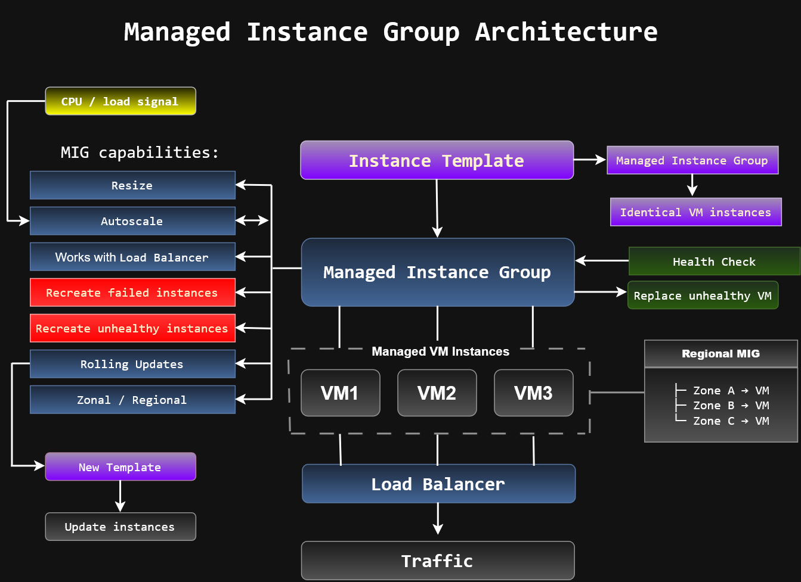

# Load Balancing and Autoscaling

## Overview

Google Cloud Load Balancing distributes traffic across compute resources in one or multiple regions.

It can help provide:

- High availability
- A single anycast IP address
- Distribution of traffic across compute resources
- Autoscaling of backend resources
- Content delivery close to users

Google Cloud Load Balancing is a fully distributed, software-defined, managed service rather than a physical load-balancing appliance.

## Managed Instance Groups



## Primary Load Balancer Types

Google Cloud provides two primary load-balancer categories:

### Application Load Balancers

Application Load Balancers operate at:

```text
Layer 7
Application Layer
```

They are designed primarily for HTTP(S) workloads.

Application Load Balancers can make routing decisions based on:

- HTTP headers
- Cookies
- URL paths

They also support features such as:

- SSL/TLS termination
- Session affinity
- Content-based routing

## Application Load Balancers

Detailed notes and architecture:

[Application Load Balancers](application-load-balancers/README.md)

### Network Load Balancers

Network Load Balancers operate at:

```text
Layer 4
Transport Layer
```

They are designed for traffic such as:

- TCP
- UDP

Network Load Balancers make routing decisions primarily using:

- IP addresses
- Ports

They are appropriate when low latency or high throughput is important.

Google Cloud Network Load Balancing includes:

```text
Proxy Network Load Balancers
Passthrough Network Load Balancers
```

## Quick Recognition

```text
HTTP(S), URL paths, cookies, headers
→ Application Load Balancer
→ Layer 7

TCP/UDP, IP addresses, ports
→ Network Load Balancer
→ Layer 4
```

## Module Topics

1. Managed Instance Groups
2. Application Load Balancers
   - Lab: Configure an Application Load Balancer with Autoscaling
3. Cloud CDN
4. Network Load Balancing
5. Internal Load Balancing
   - Lab: Configure an Internal Network Load Balancer
6. Choosing a Load Balancer

---

### Autoscaling Policies

Managed Instance Groups can automatically add or remove VM instances as workload demand changes.

Autoscaling can be based on:

- CPU utilization
- Load balancing capacity
- Cloud Monitoring metrics
- Queue-based workloads such as Pub/Sub
- Schedules

For example, if two VM instances are running at 100% and 85% CPU utilization while the target CPU utilization is 75%, the autoscaler can add another instance to distribute the workload.

```text
High utilization
      ↓
Autoscaling policy
      ↓
Add VM instance
      ↓
Distribute workload
      ↓
Move utilization toward target
```

When utilization falls sufficiently below the target, the autoscaler can remove instances while continuing to satisfy the configured utilization target.

### Monitoring Autoscaling

VM and instance-group metrics can be used to determine appropriate autoscaling settings.

Useful metrics include:

- CPU utilization
- Memory utilization
- Network traffic
- Disk utilization
- Connection activity
- Disk throughput

Cloud Monitoring can also generate alerts based on VM utilization.

### Health Checks

Health checks determine whether VM instances should continue receiving traffic.

A health check defines:

```text
Protocol
Port
Check interval
Timeout
Healthy threshold
Unhealthy threshold
```

The check interval determines how often a VM is tested.

The timeout determines how long Google Cloud waits for a response.

The healthy threshold defines how many consecutive successful checks are required.

The unhealthy threshold defines how many consecutive failed checks are required before an instance is considered unhealthy.

Managed Instance Groups can use health checks for autohealing and recreate unhealthy instances.

### Stateful IP Addresses

Managed Instance Groups can preserve internal and external IPv4 addresses across events such as:

- VM restart
- Recreation
- Autohealing
- Updates

Stateful IP configuration is useful when:

- An IP address must remain static
- Application configuration depends on a specific IP address
- A server is accessed through a dedicated static IP
- A workload must be migrated without changing its network configuration

```text
Ephemeral IP
     ↓
Stateful policy
     ↓
Static IP preserved
     ↓
Restart / recreate / autoheal / update
     ↓
Same IP retained
```

### ACE Recognition Notes

```text
Need automatic scale-out or scale-in
→ MIG autoscaler

Need scaling based on CPU
→ CPU utilization policy

Need scaling based on Pub/Sub workload
→ Queue-based autoscaling

Need scheduled capacity changes
→ Schedule-based autoscaling

Need failed or unhealthy VM replacement
→ Health check + autohealing

Need IP to survive VM recreation
→ Stateful IP configuration
```
