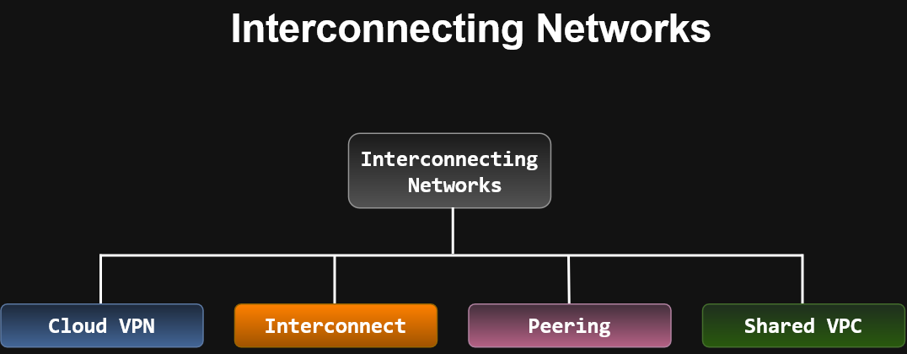
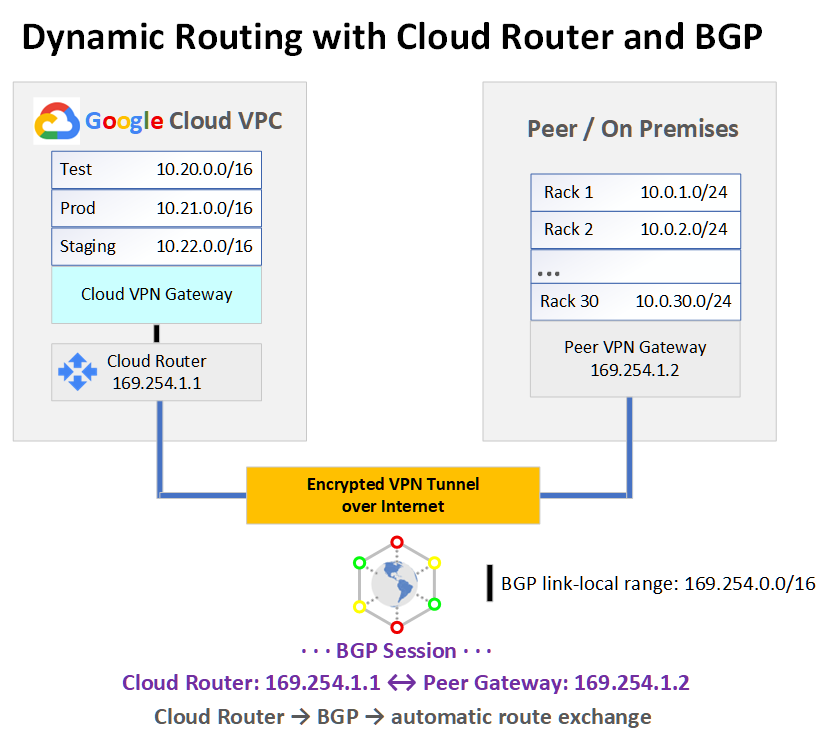
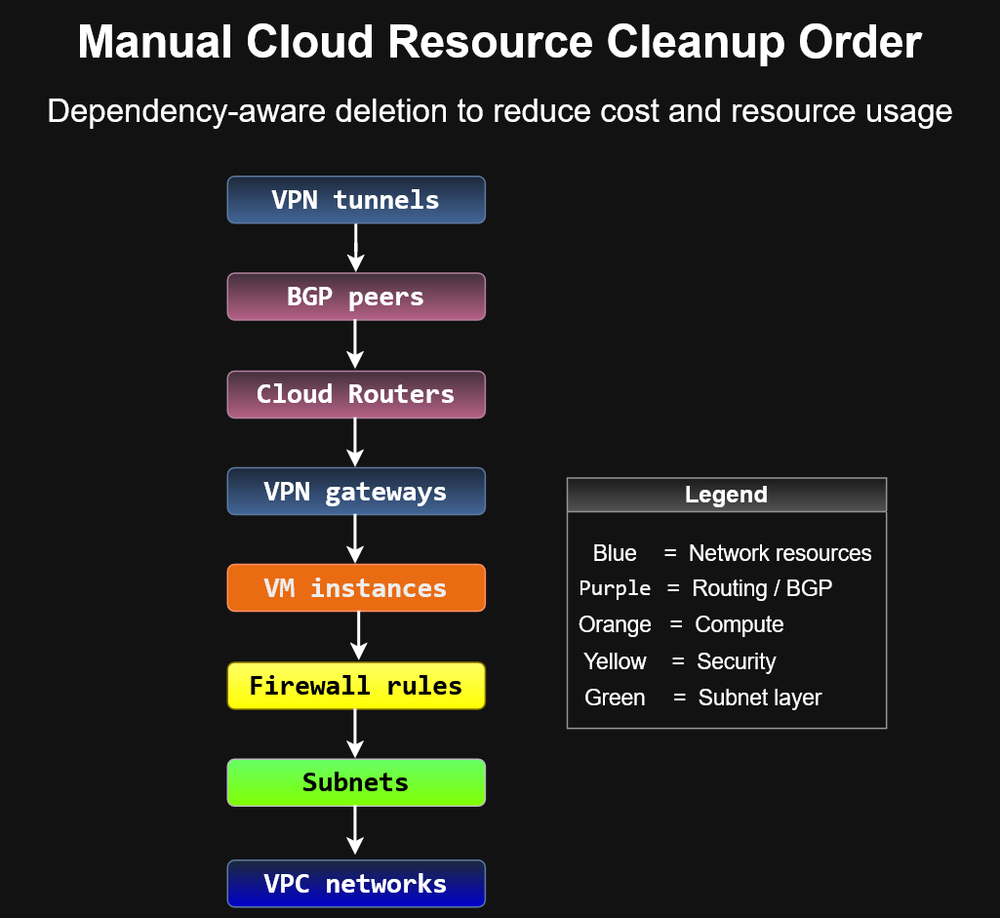

# Interconnecting Networks

Different applications and workloads require different network connectivity
solutions.

Google Cloud provides multiple options for connecting external infrastructure
to Google Cloud and for sharing networking resources within Google Cloud.



## Module Topics

1. Cloud VPN
   - Lab: Configure Google Cloud HA VPN

2. Cloud Interconnect and Peering

3. Sharing VPC Networks

## Hybrid Connectivity

The primary hybrid connectivity options covered in this module are:

- Cloud VPN
- Cloud Interconnect
- Peering

Conceptually:

```text
External Infrastructure
        |
        +-- Cloud VPN
        |
        +-- Cloud Interconnect
        |
        +-- Peering
        |
        v
   Google Cloud VPC
```
## Key Idea
Different connectivity requirements call for different solutions.
Examples of factors that can influence the choice include:
- Connectivity method
- Performance requirements
- Reliability requirements
- Network architecture
- Whether the connection is between Google Cloud and external infrastructure
- Whether networking resources need to be shared inside Google Cloud

---

## Cloud VPN

Cloud VPN securely connects an external or on-premises network to a
Google Cloud VPC network through encrypted IPsec VPN tunnels.

Google Cloud provides two Cloud VPN gateway types:

- Classic VPN
- HA VPN

---

## Classic VPN

Classic VPN securely connects an on-premises network to a Google Cloud
VPC network over the public internet using IPsec encryption.

Traffic is encrypted by one VPN gateway and decrypted by the gateway at
the other end of the connection.

Classic VPN is useful for relatively low-volume data connections.

### Classic VPN Characteristics

- 99.9% service availability SLA
- Site-to-site VPN
- Static routing
- Dynamic routing
- IKEv1 and IKEv2
- Regional Cloud VPN gateway
- Regional external IP address

Classic VPN does not provide client "dial-in" VPN connectivity.

Dynamic routes use Cloud Router.

### Classic VPN Concept

```text
Google Cloud VPC
      |
Cloud VPN Gateway
      |
Encrypted IPsec Tunnel
      |
Public Internet
      |
On-Premises VPN Gateway
      |
On-Premises Network
```
### MTU Consideration
The course notes that the on-premises VPN gateway MTU must not exceed:
```text
1460 bytes
```
This accounts for VPN encryption and packet encapsulation overhead.
---
## HA VPN
HA VPN is Google's high-availability Cloud VPN solution.
It securely connects a peer network to a Google Cloud VPC using IPsec
VPN connections.
### HA VPN Characteristics
- Up to 99.99% service availability SLA
- Two fixed gateway interfaces
- One automatically assigned external IP per interface
- Multiple VPN tunnels supported per interface
- Dynamic routing using BGP
- Cloud Router required
For the 99.99% SLA, the VPN topology must be configured with the required
redundant tunnels.
---
## HA VPN Gateway
```text
             HA VPN Gateway
              /          \
      Interface 0      Interface 1
          |                |
       Tunnel 0         Tunnel 1
          |                |
       Peer VPN Gateway(s)
```
---
### Routing Modes
HA VPN can be configured as:

```text
Active / Active
```
or:
```text
Active / Passive
```
depending on routing priorities.
---
## HA VPN Peer Configurations
The course describes three common peer gateway configurations:
1. Two peer VPN devices, each with its own IP address.
2. One peer VPN device with two separate IP addresses.
3. One peer VPN device with one IP address.
Using two physical peer gateways provides additional redundancy and allows
maintenance or failure of one gateway without losing the entire VPN
connection.
---
## HA VPN with AWS
HA VPN can connect to AWS using:
- AWS Transit Gateway
- AWS Virtual Private Gateway
The course notes that only the AWS Transit Gateway supports:

```text
ECMP
Equal-Cost Multipath Routing
```
ECMP distributes traffic across active VPN tunnels.
A supported AWS HA configuration can use four tunnels.

---
## HA VPN Between Google Cloud VPC Networks
Two Google Cloud VPC networks can also be connected by placing an HA VPN
gateway in each VPC.

Conceptually:
```text
VPC Network A
     |
HA VPN Gateway A
   /        \
Tunnel 0   Tunnel 1
   \        /
HA VPN Gateway B
     |
VPC Network B
```
The course topology provides 99.99% availability when configured with both
interfaces and redundant tunnels.
---
## Dynamic Routing with Cloud Router
Cloud Router provides dynamic route exchange for Cloud VPN.
It uses:
```text
BGP
Border Gateway Protocol
```
Cloud Router allows routes to change and propagate without changing the VPN
tunnel itself.

Conceptually:

```text
Google Cloud VPC
      |
 Cloud Router
      |
 BGP Session
      |
 VPN Tunnel
      |
Peer VPN Gateway
      |
Peer Network
```


### Why Dynamic Routing Matters
Suppose new subnets are added:
```text
Google Cloud:
10.22.0.0/16

On-premises:
10.0.30.0/24
```

With BGP, Cloud Router and the peer gateway advertise the new routes
automatically.

You do not need to manually rebuild the VPN tunnel.

### BGP Link-Local Addresses
The BGP endpoints use addresses from: 

```text
169.254.0.0/16
```
These addresses are used only for the BGP session and are not part of the
normal address space of either connected network.

---

## ACE-style notes, simple recognition block:

```text
Cloud VPN
→ Hybrid connectivity using VPN

Cloud Interconnect
→ Dedicated/private connectivity to Google Cloud

Peering
→ Network-to-network connectivity

Shared VPC
→ Share VPC networking resources across Google Cloud projects
```
```text
Need encrypted site-to-site connectivity over the public internet
→ Cloud VPN

Need high availability
→ HA VPN

Need 99.99% VPN SLA
→ Properly configured HA VPN

Need static routes
→ Classic VPN

Need dynamic route propagation
→ Cloud Router + BGP

HA VPN routing
→ Dynamic BGP only

Need automatic propagation of newly added subnets
→ Cloud Router

Need AWS multipath traffic distribution
→ AWS Transit Gateway + ECMP
```

## Classic VPN vs HA VPN
| Feature | Classic VPN | HA VPN |
|---|---|---|
| SLA | 99.9% | 99.99% when properly configured |
| Routing | Static or dynamic | Dynamic BGP |
| Cloud Router | Optional for dynamic routing | Required |
| High availability design | Limited | Yes |
| Gateway interfaces | Legacy model | Two |
| Multiple redundant tunnels | Possible | Core design |

---

## Resource Cleanup and Cost Control

Cloud resources should be removed in dependency-aware order when they are no longer needed.

Manual cleanup is useful in a real Google Cloud environment because unused resources can continue consuming resources or generating charges.

The HA VPN lab demonstrated a practical cleanup sequence:



### Cleanup Order

```text
VPN tunnels
    ↓
BGP peers
    ↓
Cloud Routers
    ↓
VPN gateways
    ↓
VM instances
    ↓
Firewall rules
    ↓
Subnets
    ↓
VPC networks
```

### Why the Order Matters

Cloud resources can depend on other resources.

For example:

- VPN tunnels depend on VPN gateways and Cloud Routers.
- BGP peers are configured on Cloud Routers.
- VM instances depend on VPC subnets.
- Subnets belong to VPC networks.

Removing dependent resources first makes it easier to delete the parent resources later.

### Cost-Control Recognition

```text
Unused cloud resource
        ↓
Continued resource consumption
        ↓
Potential ongoing cost

Proper cleanup
        ↓
Delete dependent resources first
        ↓
Remove parent infrastructure
        ↓
Reduce unnecessary resource usage
```

### Lab Observation

During manual cleanup, VM instances and Cloud Routers took longer to delete than simpler resources such as firewall rules.

The lab also used temporary Google Cloud resources that are automatically removed when the lab ends, but manual cleanup was practiced to demonstrate how resources should be removed in a real environment.

