# Configure Google Cloud HA VPN

## Lab Overview

This hands-on lab demonstrates how to configure a highly available VPN connection between two Google Cloud VPC networks.

One VPC represents the Google Cloud environment, while the second VPC simulates an on-premises network.

The lab uses:

- Google Cloud VPC
- Compute Engine
- HA VPN
- Cloud Router
- Border Gateway Protocol (BGP)
- Firewall rules
- Dynamic routing
- Global routing
- Redundant VPN tunnels

## Architecture

Two networks were configured:

### `vpc-demo`

- `vpc-demo-subnet1` — `10.1.1.0/24`
- `vpc-demo-subnet2` — `10.2.1.0/24`
- `vpc-demo-instance1`
- `vpc-demo-instance2`

### `on-prem`

The `on-prem` VPC simulated an external customer data center.

- `on-prem-subnet1` — `192.168.1.0/24`
- `on-prem-instance1`

---

### Lab Environment Created

#### Task 1: Set up a Global VPC environment
In Cloud Shell, I created a custom-mode VPC network named vpc-demo.

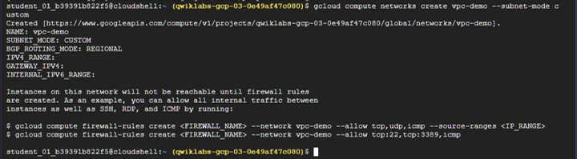

I then created two custom subnets in the vpc-demo network.

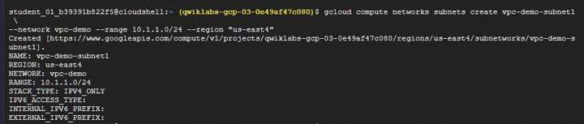

---

## HA VPN Configuration

An HA VPN gateway and Cloud Router were created for each VPC.

Cloud Router autonomous system numbers:

```text
vpc-demo-router1  → ASN 65001
on-prem-router1   → ASN 65002
```

Two redundant VPN tunnels were configured between the gateways.

```text
vpc-demo                    on-prem
   │                           │
HA VPN                       HA VPN
   │                           │
Tunnel 0 ←────────────────→ Tunnel 0
Tunnel 1 ←────────────────→ Tunnel 1
   │                           │
Cloud Router               Cloud Router
   │                           │
 BGP                         BGP
```
#### Task 2: Set up a simulated on-premises environment

In Cloud Shell, I created a second Virtual Private Cloud (VPC) named on-prem to simulate an on-premises environment that connects to Google Cloud.

I configured firewall rules and created the Compute Engine VM instances used by the lab.

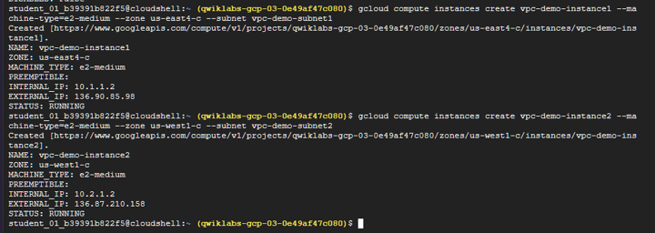

I then listed the VM instances to verify their zones and IP addresses.

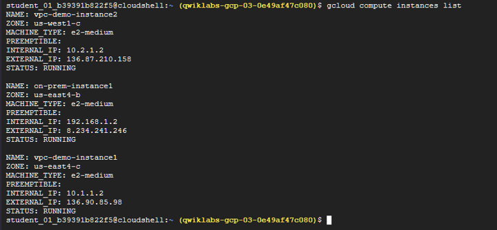

## Dynamic Routing with BGP

BGP peers were configured for both VPN tunnels.

Link-local addresses from the `169.254.0.0/16` range were used for the BGP sessions.

Example:

```text
Tunnel 0
169.254.0.1 ↔ 169.254.0.2

Tunnel 1
169.254.1.1 ↔ 169.254.1.2
```

Dynamic routing allows network routes to be exchanged automatically through Cloud Router.

#### Task 3: Set up HA VPN gateways and Cloud Routers

I created an HA VPN gateway in each VPC network.

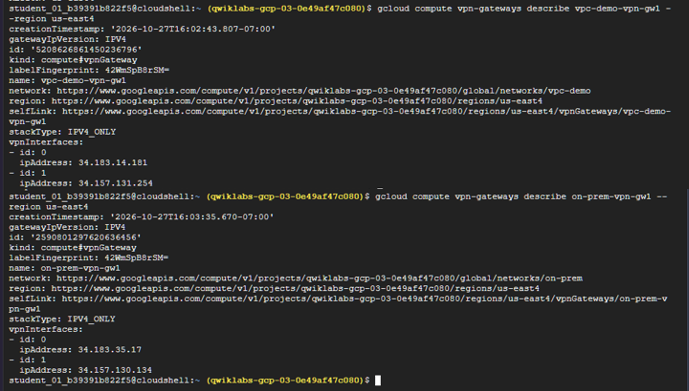

I also created a Cloud Router for each network to support dynamic routing.

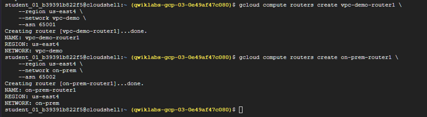

#### Task 4: Create VPN tunnels

I created redundant VPN tunnels between the two HA VPN gateways.

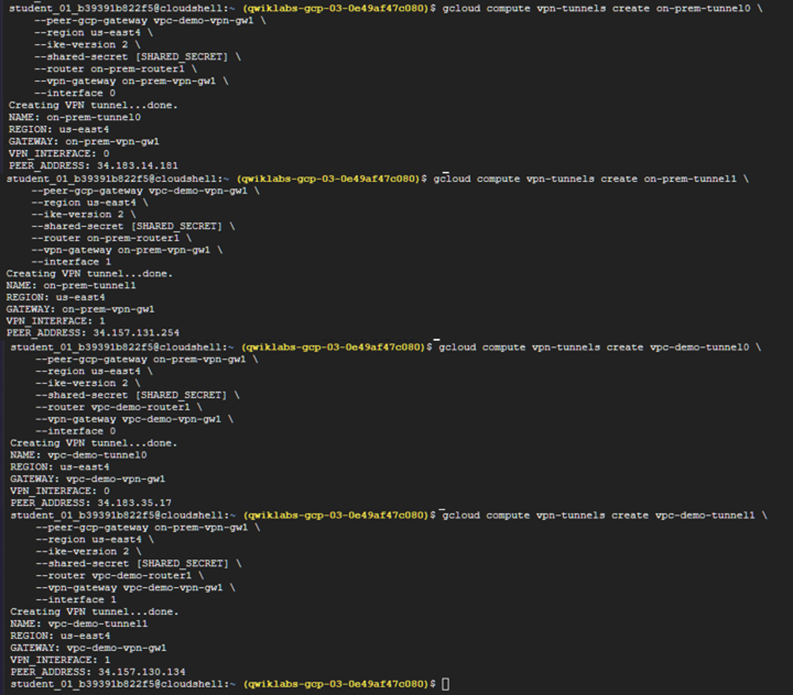

For the HA VPN configuration, interface 0 on one gateway connects to interface 0 on the remote gateway, and interface 1 connects to interface 1 on the remote gateway.

#### Task 5: Create BGP peering

I configured Border Gateway Protocol (BGP) peering for the VPN tunnels.

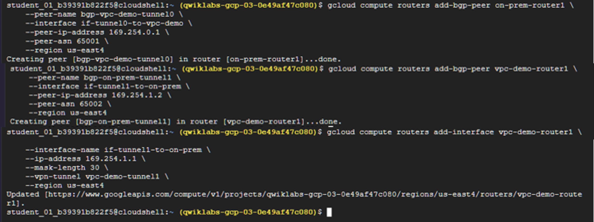

#### Task 6: Verify router configurations and connectivity
I verified the Cloud Router configurations, firewall rules, VPN tunnel status, and private connectivity between the two VPC networks.

HA VPN uses dynamic routing with BGP to support the high-availability configuration.

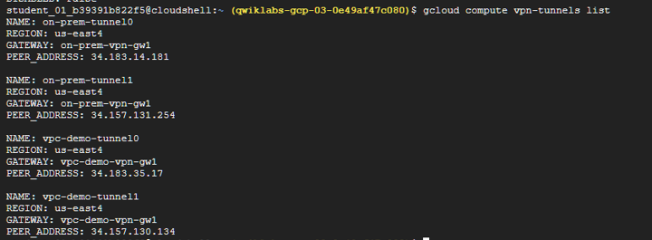

I confirmed that the VPN tunnels were established and running.

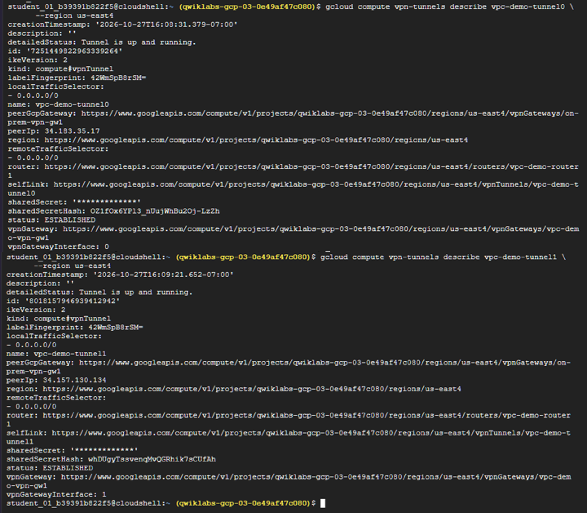

## Private Connectivity Test

Next, I connected to on-prem-instance1 using SSH:
```text
gcloud compute ssh on-prem-instance1 --zone us-east4-b
```
The prompt changed to:
```text
...@on-prem-instance1:~$
```
From that SSH session, I tested private connectivity to the vpc-demo network.

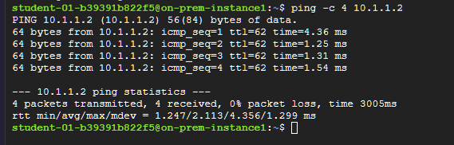

Because HA VPN and Cloud Router are regional resources, I enabled global routing on vpc-demo so Cloud Router could see and advertise routes from other regions.

I then returned to the SSH session on on-prem-instance1 and tested connectivity to the VM in the second region.

From `on-prem-instance1`, private connectivity to `vpc-demo-instance1` was verified:

```text
Destination: 10.1.1.2

4 packets transmitted
4 packets received
0% packet loss
```
This confirmed that private traffic could travel between the two VPC networks through the HA VPN.

## Global Routing

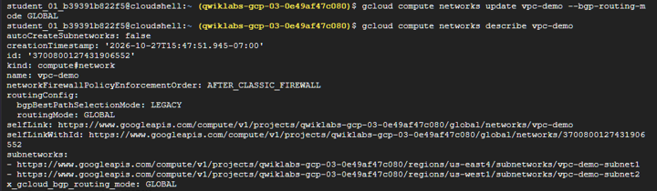

The `vpc-demo` VPC routing mode was changed from regional to:

```text
GLOBAL
```

This allowed Cloud Router to advertise routes for subnets located in another region.

Connectivity from `on-prem-instance1` to `vpc-demo-instance2` was then verified:

```text
Destination: 10.2.1.2

2 packets transmitted
2 packets received
0% packet loss
```
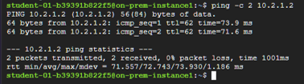

## HA VPN Failover Test

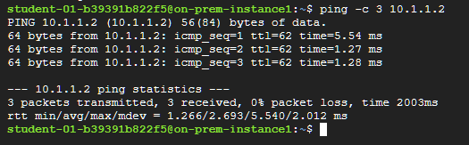

One VPN tunnel was removed to simulate a tunnel failure.

Connectivity was then tested again from `on-prem-instance1` to `vpc-demo-instance1`.

```text
3 packets transmitted
3 packets received
0% packet loss
```

Traffic continued through the remaining VPN tunnel.

This demonstrated HA VPN redundancy and failover.

## Resource Cleanup


The lab also included manual deletion of cloud resources.

A dependency-aware cleanup sequence was used:

```text
VPN tunnels
    ↓
BGP peers
    ↓
Cloud Routers
    ↓
VPN gateways
    ↓
VM instances
    ↓
Firewall rules
    ↓
Subnets
    ↓
VPC networks
```

Manual cleanup is important in production cloud environments because unused resources can continue consuming resources or generating costs.

## Skills Demonstrated

- Creating custom VPC networks
- Creating regional subnets
- Deploying Compute Engine instances
- Configuring firewall rules
- Creating HA VPN gateways
- Creating redundant VPN tunnels
- Configuring Cloud Router
- Configuring BGP peers
- Working with BGP ASNs
- Using link-local BGP addresses
- Verifying private VPN connectivity
- Configuring global dynamic routing
- Testing HA VPN failover
- Cleaning up dependent Google Cloud resources

```text
Lab Overview
↓
Architecture
↓
Evidence of environment creation
↓
HA VPN configuration
↓
Gateway/router/tunnel screenshots
↓
BGP configuration
↓
Tunnel verification
↓
Private connectivity proof
↓
Global routing proof
↓
Failover proof
↓
Cleanup
↓
Skills Demonstrated
↓
Result
```
---
## Result

Successfully configured and tested a highly available Google Cloud VPN architecture using redundant VPN tunnels, Cloud Router, and BGP.

The final failover test confirmed continued connectivity with:

```text
3/3 packets received
0% packet loss
```
